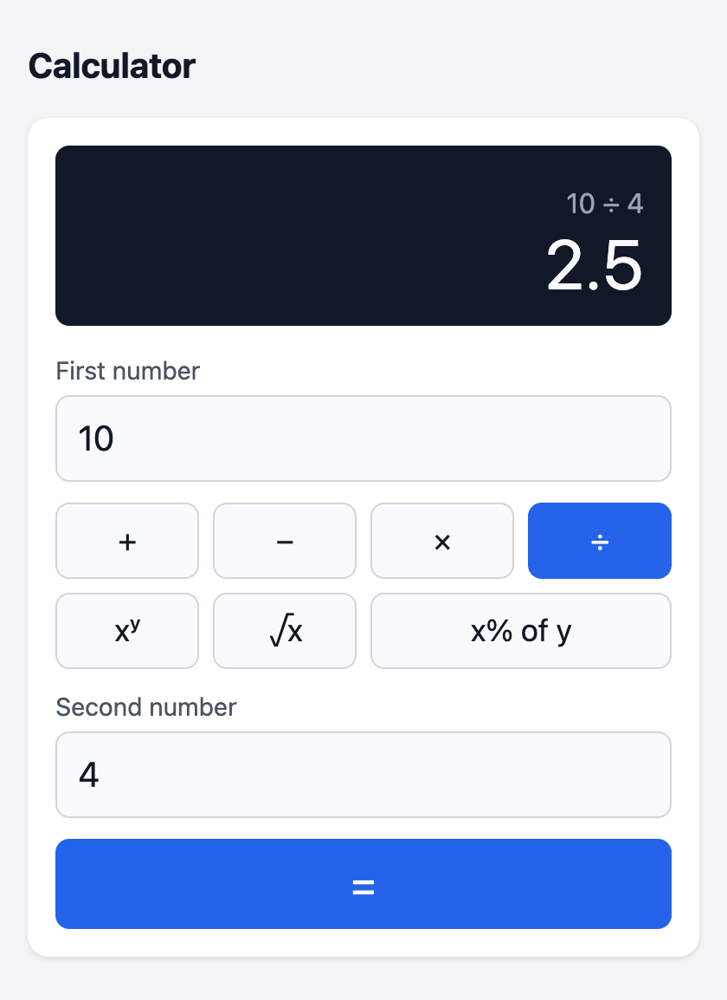

# Full-stack Calculator

[](https://github.com/robaraujo404/fullstack-calculator/actions/workflows/ci.yml)

A calculator with a React + TypeScript frontend and a Go REST API. Every calculation runs on the backend; the frontend validates the input format and presents results and errors.



- **Operations:** add, subtract, multiply, divide, plus the optional power, square root and percentage.
- **API:** JSON in and out, with one error format for every failure (400, 404, 405, 413, 415, 422, 500), covering division by zero, invalid data and overflow.
- **UI:** works with the keyboard alone, announces results to screen readers and fits a 375 px screen.
- **Quality:** unit tests and coverage reports for both layers. CI runs lint, type checks, tests and a smoke test of the Docker image.

## Quick start (Docker)

```bash
docker build -t calculator .
docker run --rm -p 8080:8080 calculator
```

Open http://localhost:8080. One container serves both the API and the frontend build. CI builds this image and smoke-tests it on every push.

## Local development

**Prerequisites:** Go 1.27+ and Node 24 (`frontend/.nvmrc`). `make` is optional.

```bash
make install        # frontend dependencies (npm ci)
make run-backend    # API on http://localhost:8080
make run-frontend   # UI on http://localhost:5173, in a second terminal
```

Without `make`: `cd backend && go run ./cmd/server`, then `cd frontend && npm ci && npm run dev`.

The Vite dev server proxies `/api` to port 8080, so the browser talks to a single origin and the API needs no CORS setup.

The server reads two environment variables:

| Variable | Default | Purpose |
|---|---|---|
| `PORT` | `8080` | HTTP port |
| `STATIC_DIR` | unset | When set, the server also serves the frontend build from this directory (used by the Docker image) |

## Tests and coverage

```bash
make test       # go test -race ./... and the Vitest suite
make coverage   # HTML reports, plus text summaries in docs/coverage/
```

Other checks, as run in CI:

- **Backend:** `cd backend && gofmt -l . && go vet ./...`
- **Frontend:** `cd frontend && npm run lint && npm run typecheck && npm run build`

Coverage measured on 2026-10-27 with Go 1.27.3, Node 24.22 and Vitest 5.0.5:

| Layer | Scope | Coverage |
|---|---|---|
| Backend | `internal/calculator` | 100% of statements |
| Backend | `internal/httpapi` | 96.9% of statements |
| Frontend | every file in `src/`, tested or not (tests and `main.tsx` excluded) | 100% of lines, branches and functions |

Full reports are in [`docs/coverage/backend.txt`](docs/coverage/backend.txt) and [`docs/coverage/frontend.txt`](docs/coverage/frontend.txt).

- **`cmd/server`** only wires the configuration and the HTTP server. The Docker smoke test exercises it instead of unit tests.
- **Uncovered lines in `httpapi`** are defensive branches (logging an unexpected 500, re-raising `http.ErrAbortHandler`) and `requestError.Error`, which the handler never calls.

## API

`POST /api/v1/{operation}` with a JSON body. The request must send `Content-Type: application/json`.

| Operation | Body | Result |
|---|---|---|
| `add` | `{"a": n, "b": n}` | a + b |
| `subtract` | `{"a": n, "b": n}` | a − b |
| `multiply` | `{"a": n, "b": n}` | a × b |
| `divide` | `{"a": n, "b": n}` | a ÷ b |
| `power` | `{"a": n, "b": n}` | aᵇ |
| `sqrt` | `{"a": n}` | √a |
| `percentage` | `{"a": n, "b": n}` | a% of b |

`GET /healthz` returns `{"status":"ok"}`.

A successful call returns the operation and its result:

```json
{"operation": "divide", "result": 2.5}
```

Every error response under `/api/` has the same shape:

```json
{"error": {"code": "DIVISION_BY_ZERO", "message": "division by zero is undefined"}}
```

| Status | Code | When |
|---|---|---|
| 400 | `INVALID_REQUEST` | The body is empty, malformed or not a JSON object, has a wrong type (`"a": "2"`), an unknown field or trailing data, or a number outside the float64 range (`1e400`) |
| 400 | `MISSING_OPERAND` | `a` is missing or `null`, or `b` is missing for a binary operation |
| 400 | `UNEXPECTED_OPERAND` | `b` is sent to `sqrt` |
| 404 | `UNSUPPORTED_OPERATION` | The operation doesn't exist (with any method) |
| 404 | `NOT_FOUND` | Any other path under `/api/` |
| 405 | `METHOD_NOT_ALLOWED` | A method other than POST on an existing operation; includes `Allow: POST` |
| 413 | `PAYLOAD_TOO_LARGE` | The body is larger than 1 KiB |
| 415 | `UNSUPPORTED_MEDIA_TYPE` | `Content-Type` isn't `application/json`; `charset` parameters are accepted |
| 422 | `DIVISION_BY_ZERO` | `divide` with `b = 0` |
| 422 | `INVALID_OPERAND` | No real result, e.g. `sqrt(-1)` or `(-8)^0.5` |
| 422 | `RESULT_OUT_OF_RANGE` | The result overflows float64, e.g. `1e308 × 10` |
| 500 | `INTERNAL_ERROR` | Unexpected server error |

**400 vs 422.** 400 means the request is malformed. 422 means it is well formed but mathematically invalid.

### Examples

```bash
$ curl -s -X POST localhost:8080/api/v1/add -H 'Content-Type: application/json' -d '{"a":2,"b":3}'
{"operation":"add","result":5}

$ curl -s -X POST localhost:8080/api/v1/subtract -H 'Content-Type: application/json' -d '{"a":10,"b":4}'
{"operation":"subtract","result":6}

$ curl -s -X POST localhost:8080/api/v1/multiply -H 'Content-Type: application/json' -d '{"a":-2,"b":0.5}'
{"operation":"multiply","result":-1}

$ curl -s -X POST localhost:8080/api/v1/divide -H 'Content-Type: application/json' -d '{"a":10,"b":4}'
{"operation":"divide","result":2.5}

$ curl -s -X POST localhost:8080/api/v1/power -H 'Content-Type: application/json' -d '{"a":2,"b":10}'
{"operation":"power","result":1024}

$ curl -s -X POST localhost:8080/api/v1/sqrt -H 'Content-Type: application/json' -d '{"a":16}'
{"operation":"sqrt","result":4}

$ curl -s -X POST localhost:8080/api/v1/percentage -H 'Content-Type: application/json' -d '{"a":15,"b":200}'
{"operation":"percentage","result":30}
```

Errors:

```bash
$ curl -s -X POST localhost:8080/api/v1/divide -H 'Content-Type: application/json' -d '{"a":1,"b":0}'
{"error":{"code":"DIVISION_BY_ZERO","message":"division by zero is undefined"}}

$ curl -s -X POST localhost:8080/api/v1/sqrt -H 'Content-Type: application/json' -d '{"a":-1}'
{"error":{"code":"INVALID_OPERAND","message":"operand is outside the operation's domain"}}

$ curl -s -X POST localhost:8080/api/v1/add -H 'Content-Type: application/json' -d '{"a":"2","b":3}'
{"error":{"code":"INVALID_REQUEST","message":"field \"a\" must be a number within float64 range"}}

$ curl -s -X POST localhost:8080/api/v1/add -H 'Content-Type: application/json' -d '{"a":2}'
{"error":{"code":"MISSING_OPERAND","message":"operand \"b\" is required for add"}}

$ curl -s -X POST localhost:8080/api/v1/modulo -H 'Content-Type: application/json' -d '{"a":1,"b":2}'
{"error":{"code":"UNSUPPORTED_OPERATION","message":"unsupported operation \"modulo\""}}

$ curl -s -X POST localhost:8080/api/v1/add -d '{"a":2,"b":3}'
{"error":{"code":"UNSUPPORTED_MEDIA_TYPE","message":"send Content-Type: application/json"}}

$ curl -s -i localhost:8080/api/v1/add
HTTP/1.1 405 Method Not Allowed
Allow: POST
Content-Type: application/json; charset=utf-8

{"error":{"code":"METHOD_NOT_ALLOWED","message":"method GET is not allowed; use POST"}}
```

## Project structure

```
backend/
  cmd/server/            entry point: config, HTTP server, graceful shutdown
  internal/calculator/   pure domain: operation registry, Apply, sentinel errors
  internal/httpapi/      routing, request decoding, error mapping, middleware
frontend/src/
  api/                   fetch client; every failure becomes an ApiError
  domain/                operation metadata, input parsing, result formatting
  hooks/                 useCalculator: request state (idle, loading, success, error)
  components/            Calculator form, OperandInput, ResultPanel
docs/                    AI prompts, coverage summaries, screenshot
Dockerfile               multi-stage build into one distroless image
.github/workflows/ci.yml backend, frontend and Docker smoke-test jobs
```

## Design decisions

| Decision | Why | Alternative considered |
|---|---|---|
| Go standard library only, with an operation registry | The 1.22+ `ServeMux` covers the routing; no dependencies to review. With seven operations and a UI that mirrors their arity, a name → `{arity, fn}` map keeps the handler generic. | A web framework; a `switch` (enough for four operations) |
| One POST endpoint per operation, JSON body | Self-describing URLs, one typed contract and the same validation for every operation | GET with query parameters (also valid, since calculations have no side effects); a single `/calculate` endpoint |
| 400 vs 422 | Lets a client tell "fix your request" apart from "this math has no answer" without parsing messages | 400 for everything |
| Every `/api` response is JSON; no CORS | `ServeMux` answers 405 in plain text and stops answering it once a `/` file server is registered, so the handler checks the method itself and `/api/` catches unknown paths. The Vite proxy and the single container make every request same-origin. | Rely on the default 404/405; add a CORS middleware |
| float64 end to end; formatting only for display | Matches JSON and JavaScript numbers. Non-finite results are rejected in one place (`Operation.Apply`), and `-0` is normalized. | `math/big.Rat` or `shopspring/decimal`, the right choice for money but not for `sqrt` and `power`, whose results are irrational |
| A form styled as a calculator, not a keypad | Input validation stays visible. A keypad needs a state machine, and without arithmetic in the frontend, chaining (`2 + 3 × 4`) would mean an API call per operator. | Classic keypad with a reducer |
| One Dockerfile, validated by a CI smoke test | The Go binary serves the API and the static build from one distroless image. CI proves the image builds and runs without Docker on the dev machine. | docker-compose with nginx in front of the API |

## Assumptions

- **Percentage:** `percentage(a, b)` is a% of b, computed as `a * b / 100` (15% of 200 = 30). Multiplying first keeps common cases exact (7% of 100 is 7, not `7.000000000000001`), but it overflows earlier for operands near the float64 limit: `percentage(1e308, 10)` returns 422.
- **Power:** uses `math.Pow`, so `0^0 = 1` and `0^-1` returns 422 `RESULT_OUT_OF_RANGE`.
- **Input format:** the decimal separator is a dot. Inputs accept a sign, decimals and scientific notation (`1e6`).
- **Underflow:** numbers smaller than the smallest float64, such as `1e-400`, become 0.
- **Display:** the UI shows non-integers rounded to 15 significant digits, so `0.1 + 0.2` shows `0.3`. Integers are shown exactly. The API returns the raw float64.
- **Requests:** operation names are case-sensitive, and request bodies are limited to 1 KiB.

## Known limitations and future improvements

- **No expressions or history:** there is no parser or chaining (`2 + 3 × 4`), no calculation history and no persistence.
- **float64 arithmetic:** fine for a general calculator, but monetary values would need a decimal type with explicit scale and rounding.
- **Display rounding:** non-integer results between 1e15 and 2^52 (above that, every float64 is an integer) are displayed rounded to 15 significant digits.
- **Possible next steps:** an OpenAPI description of the API, request rate limiting, and keyboard shortcuts for the operations.

## AI usage

Built with Claude Code. Every prompt is recorded in [`docs/PROMPTS.md`](docs/PROMPTS.md). Planning and the review of competing plans took about two hours, and the implementation, tests and documentation about one hour.
